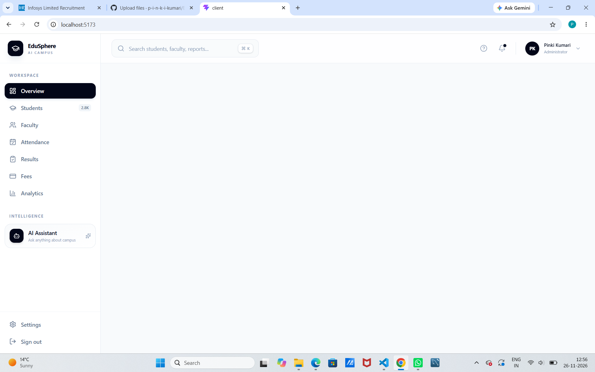
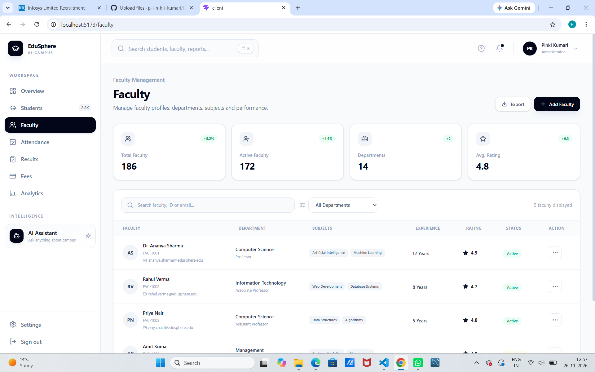
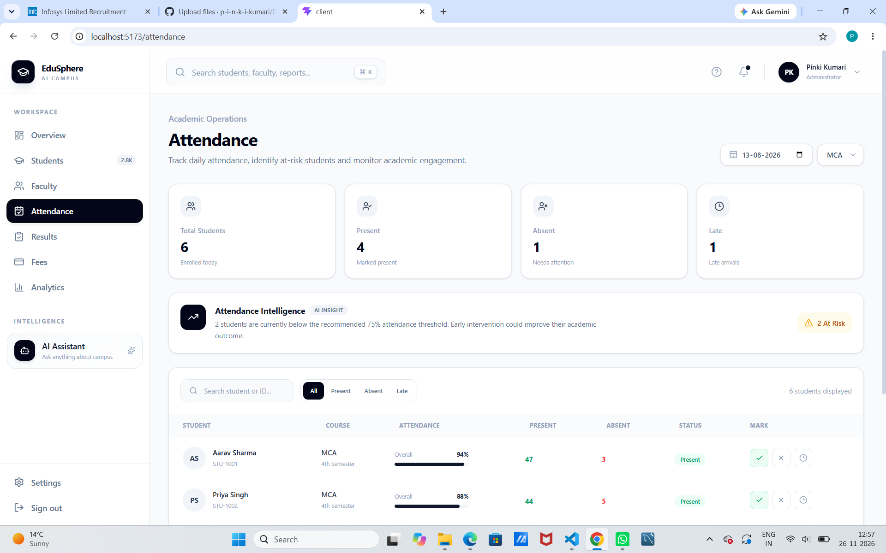

# EduSphere AI Pro

A full-stack educational management platform for managing students, faculty, attendance, results and fees from a single admin dashboard.

**Status:** In active development. Some modules currently use sample data.

## Screenshots

| Overview | Faculty | Attendance |
| --- | --- | --- |
|  |  |  |

## Features

- Login and signup with JWT authentication
- Passwords hashed with bcryptjs
- Role-based access control with separate permissions for Admin and Student
- Admin dashboard with an overview of the campus
- Modules: Students, Faculty, Attendance, Results, Fees and Analytics
- AI Assistant section (interface in progress)
- REST APIs connected to MongoDB

## Tech Stack

- **Frontend:** React.js (Vite), HTML, CSS, JavaScript
- **Backend:** Node.js, Express.js
- **Database:** MongoDB
- **Authentication:** JWT, bcryptjs

## Project Structure

```
EduSphere-AI-Pro/
├── backend/     # Express server, routes, controllers, models
├── frontend/    # React application
└── .gitignore
```

## Getting Started

### Prerequisites

- Node.js (v18 or later)
- MongoDB (local installation or MongoDB Atlas)

### 1. Clone the repository

```bash
git clone https://github.com/p-i-n-k-i-kumari/EduSphere-AI-Pro.git
cd EduSphere-AI-Pro
```

### 2. Set up the backend

```bash
cd backend
npm install
```

Create a `.env` file inside `backend/`:

```
PORT=5000
MONGO_URI=your_mongodb_connection_string
JWT_SECRET=your_secret_key
```

Start the server:

```bash
npm start
```

### 3. Set up the frontend

```bash
cd frontend
npm install
npm run dev
```

The app runs at `http://localhost:5173`.

## Roles

| Role | Access |
| --- | --- |
| Admin | Full access to all modules |
| Student | Limited access based on student permissions |

## Future Improvements

- Connect all modules to live database records
- Complete the AI Assistant
- Add automated tests

## Author

**Pinki Kumari**
[GitHub](https://github.com/p-i-n-k-i-kumari) | [LinkedIn](https://linkedin.com/in/pinki-kumari-209288271)
